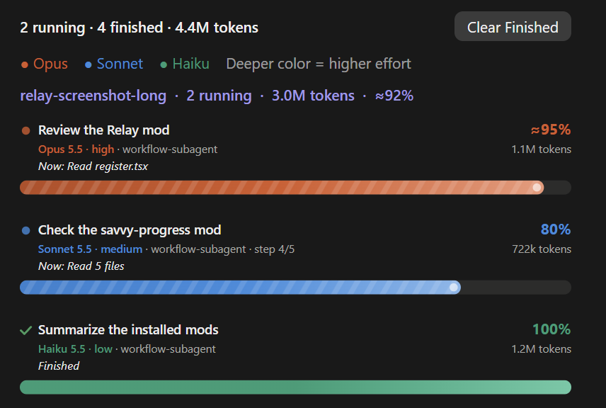
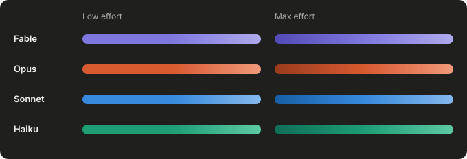

# Relay

Relay is a Claude Code mod that keeps a pane next to the chat showing every agent and subagent while it works. When a workflow fans out to several agents, it's hard to tell who is doing what without opening each one.



The pane opens by itself when a workflow starts or when two subagents run at the same time. Agents sit under the workflow's name, or under "Subagents" when they weren't started by a workflow. Each row has the task the agent was given and what it's doing right now, which is its latest tool call ("Edit register.tsx", "Bash npm test"). It also shows the model and effort, the tokens used so far, and a progress bar with slow-moving stripes.

## Colors

The model decides the bar's color. Fable is purple, Opus is coral, Sonnet is blue and Haiku is teal; anything else is gray. Higher effort starts the bar on a deeper shade, so an Opus agent on max looks darker than one on low. The key at the top of the pane lists only the models you can see.



## About the percent

Claude Code doesn't tell a mod how big an agent's job is, so the percent is a guess, and it says so with "≈". Relay divides the tokens an agent has used by the average used by agents that already finished in the session, or by 600k if none have finished yet. The bar slows down as it climbs, so a long run keeps moving instead of parking near the top, and it won't go past 95% until the agent is actually done. If an agent reports its own steps through a `step` tool, the way savvy-flow workers do, you see the exact "step 3/5" instead.

## Install

At the prompt of a Claude Code terminal session:

```
/plugin install relay --marketplace DanberkmanPracticed/relay
```

Answer `y` to add the marketplace, then pick a scope.

From a shell:

```
claude plugin install relay --marketplace DanberkmanPracticed/relay
```

## Using it

Type `/relay` to open the pane yourself. Clear Finished removes the agents that are done. In a terminal the pane is drawn in text, with the bar as colored blocks. If your system asks for reduced motion, the stripes stop moving.

## License

MIT
